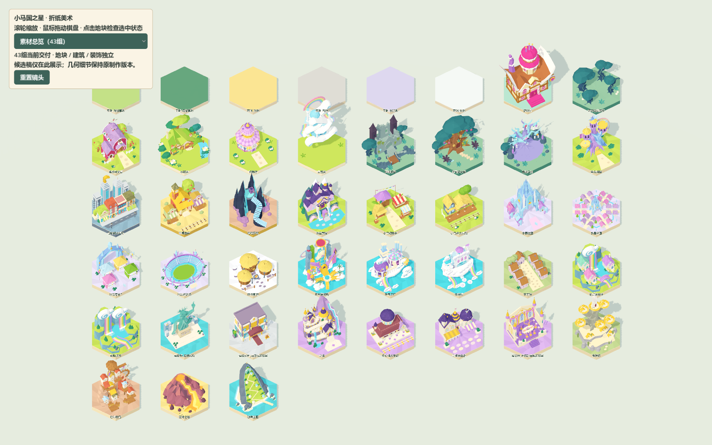
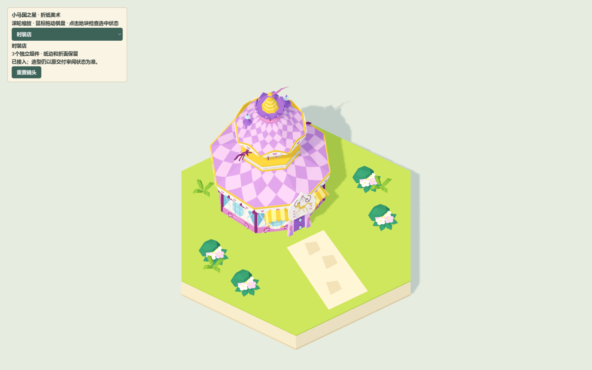

# 素材清单与地图匹配

2026-10-24快照，仅供检查；在线地图始终从服务器读取。

| 资产 | 独立组件 | 当前地图格位 | 状态 |
|---|---|---|---|
| 基础_浅绿草地 | terrain | 资源库备用 | 基础资产 |
| 基础_深绿草地 | terrain | 资源库备用 | 基础资产 |
| 基础_沙地 | terrain | 资源库备用 | 基础资产 |
| 基础_石地 | terrain | 资源库备用 | 基础资产 |
| 基础_水晶地 | terrain | 资源库备用 | 基础资产 |
| 基础_雪地 | terrain | 资源库备用 | 基础资产 |
| 糖块屋 | terrain, building | A13 | 已接入，外观沿用原稿待审阅状态 |
| 无尽自由森林 | terrain, decoration | B1, B2, B3, B4, B5, B6, B7, B8, B9, B10, B11, B12, B13, B14, B15, B17, B18, B20, B21, B23, B24, B25, B26, B27, B28, B29, B30, B31, B32, B33 | 已接入，外观沿用原稿待审阅状态 |
| 香甜苹果园 | terrain, building, decoration | A4 | 已接入，外观沿用原稿待审阅状态 |
| 小蝶家 | terrain, building, decoration | A18 | 已接入，外观沿用原稿待审阅状态 |
| 时装店 | terrain, building, decoration | A16 | 已接入，外观沿用原稿待审阅状态 |
| 云宝家 | terrain, building, decoration | A7 | 已接入，外观沿用原稿待审阅状态 |
| 姐妹城堡 | terrain, building, decoration | B16 | 已接入，外观沿用原稿待审阅状态 |
| 泽可拉小屋 | terrain, building, decoration | B19 | 已接入，外观沿用原稿待审阅状态 |
| 谐律之树 | terrain, building, decoration | B22 | 已接入，外观沿用原稿待审阅状态 |
| 暮光城堡 | terrain, building, decoration | A2 | 已接入，外观沿用原稿待审阅状态 |
| 马哈顿火车站 | terrain, building, decoration | E8 | 已接入，外观沿用原稿待审阅状态 |
| 苹果鲁萨 | terrain, building, decoration | J4 | 已接入，外观沿用原稿待审阅状态 |
| 塔塔罗斯 | terrain, building, decoration | G1 | 已接入，外观沿用原稿待审阅状态 |
| 友谊学院 | terrain, building, decoration | A6 | 已接入，外观沿用原稿待审阅状态 |
| 小马镇集市 | terrain, building, decoration | A9 | 已接入，外观沿用原稿待审阅状态 |
| 小马谷火车站 | terrain, building, decoration | A15 | 已接入，外观沿用原稿待审阅状态 |
| 水晶城堡 | terrain, building, decoration | C5 | 已接入，外观沿用原稿待审阅状态 |
| 水晶帝国 | terrain, building, decoration | C10 | 已接入，外观沿用原稿待审阅状态 |
| 水晶集市_候选方案 | terrain, building, decoration | C9 | 候选，仅预览 |
| 水晶运动场 | terrain, building, decoration | C13 | 已接入，外观沿用原稿待审阅状态 |
| 牦牦斯坦 | terrain, building, decoration | C1 | 已接入，外观沿用原稿待审阅状态 |
| 天马维加斯 | terrain, building, decoration | L2 | 已接入，外观沿用原稿待审阅状态 |
| 天气工厂 | terrain, building, decoration | L7 | 已接入，外观沿用原稿待审阅状态 |
| 云中城 | terrain, building, decoration | L8 | 已接入，外观沿用原稿待审阅状态 |
| 平等镇 | terrain, building, decoration | K1 | 已接入，外观沿用原稿待审阅状态 |
| 彩虹瀑布镇 | terrain, building, decoration | K8 | 已接入，外观沿用原稿待审阅状态 |
| 彩虹瀑布 | terrain, building, decoration | K9 | 已接入，外观沿用原稿待审阅状态 |
| 马哈顿_友谊雕像 | terrain, building, decoration | E7 | 已接入，外观沿用原稿待审阅状态 |
| 高档场所_酒店候选方案 | terrain, building, decoration | E2 | 候选，仅预览 |
| 皇城 | terrain, building, decoration | F5 | 已接入，外观沿用原稿待审阅状态 |
| 中心城火车站 | terrain, building, decoration | F4 | 已接入，外观沿用原稿待审阅状态 |
| 皇城商业街 | terrain, building, decoration | F9 | 已接入，外观沿用原稿待审阅状态 |
| 宴会厅_开放剖面候选方案 | terrain, building, decoration | F3 | 候选，仅预览 |
| 狮鹫岩 | terrain, building, decoration | D6 | 已接入，外观沿用原稿待审阅状态 |
| 巴尔的马 | terrain, building, decoration | G5 | 已接入，外观沿用原稿待审阅状态 |
| 巨龙之地 | terrain, building, decoration | H6 | 已接入，外观沿用原稿待审阅状态 |
| 骏鹰王国 | terrain, building, decoration | I7 | 已接入，外观沿用原稿待审阅状态 |

市政厅制作源尚未标准化，本轮保留原基础地块。三个候选资产虽有名称对应格位，正式地图仍不启用。

115个GLB共47,953,872字节，源库累计约1,000,979三角面；这是单份资产总和，不是单帧地图渲染面数。尚未制定手机端面数与材质批次预算。

