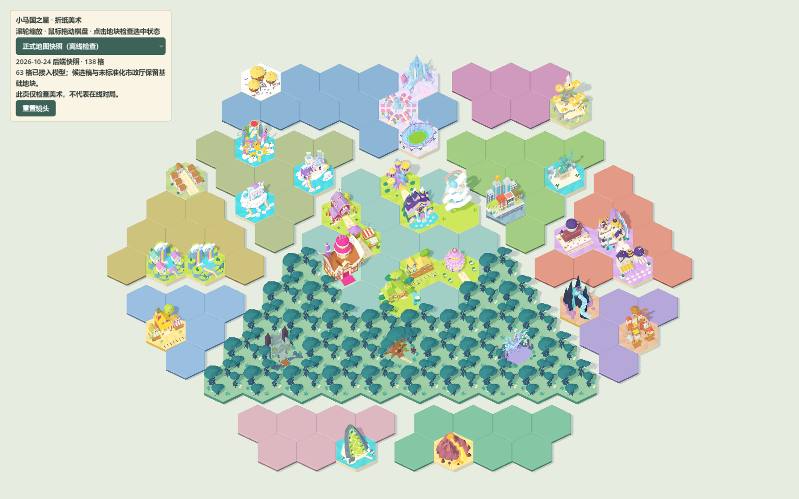

# 折纸美术前端交接 · 2026-10-24

## 当前交付

美术源工作区：`I:\blender文件\小马国之心`；客户端位于其 `equestria-star-client` 子目录。
43组、115个独立GLB组件，总计约45.73 MiB。原 `.blend`、`.spp` 与制作目录不改写、不提交到客户端仓库；每个导出记录源文件SHA256、产物SHA256、尺寸和装配偏移。

从公开主地图读取的2026-10-24快照有138格，其中63格按名称安装现有地标或森林模型。其余使用原客户端可交互地块。快照仅供离线美术检查，在线地图始终使用服务器数据。



## 已继承的项目约定

- 明亮、舒服的折纸童话；真实折面、插接和纸芯边缘比表面噪点更重要。
- 母版2 × √3 × 0.2米，源文件Z向上、顶面Z=0、X两端为顶点。
- 地块、建筑、装饰分开；复用原制作资产，不能以合并整个地标来掩盖层级问题。
- 独立组件可能有 `assembly_offset_metres`；导出先恢复ROOT装配位置，再转换到GLB的Y向上。
- 前端尖顶六角采用已有q/r公式；整组资产绕Y旋转30°以匹配地块轮廓，位置继续使用已有转换器与A—L区域偏移。
- 源半径1米，地图显示半径默认0.55，所以等比缩放0.55；默认厚度改为0.11，顶面仍在0。自定义厚度只调整Terrain，建议始终保持厚度=半径×0.2，避免含地形起伏的Terrain与装饰错位。
- 棋子留位、近景细节、铁路、公共卡栏等原美术要求继续有效；本轮不重写玩法或猜测铁路路径。

## 材质、光照与UI

导出保留图片贴纸和Alpha，包括时装店屋顶印花与马饰贴纸；程序化颜色转为原材质基础纸色，粗糙度0.92、金属度0。Blender程序纸纤维和凹凸节点**未烘焙**，不能把本轮GLB称为与Cycles材质完全一致。

保留大折面法线与真实纸片，不自动减面或焊接纸层。纹理随GLB内嵌。Godot使用暖主光、冷环境补光、Filmic色调映射、降低阴影不透明度及4×MSAA。修复旧环境设置引用不存在Sky而导致环境补光失效的问题。默认验证目标为项目Mobile渲染器；兼容渲染器初次检查发现高光差异，最终调色以Mobile实图为依据。

既有UI采用暖纸白面板、青绿色按钮及浅纸边，不改变现有布局、卡片数据或业务按钮。完整卡架重设计、专属图标、纸纹烘焙、手机性能/LOD与近景细节切换仍属于后续工作。

## 资产映射与回退

`assets/art/origami/catalog.json` 是唯一资产索引；导出脚本SPECS维护稳定英文ID和明确别名。
`OrigamiArtCatalog` 使用名称匹配，不能绑定临时数字格子ID。已支持方糖屋/糖块屋、甜苹果园/香甜苹果园、韵律之树/谐律之树、耗耗斯坦/牦牦斯坦等当前服务端写法；不擅自改写后端名称。

水晶集市、高档场所、宴会厅保持候选标记，只在美术库展示，正式地图回退基础地块。市政厅仅有未标准化制作源，本轮未强行导出。其他资产继承各地块README的待审阅状态；技术通过不等于美术定稿。

`GameMapScene.UseOrigamiArt=false` 可恢复原占位渲染。替换模型仍使用独立InteractionArea、HighlightMesh和原CellId，镜头包围盒计入高建筑。地图预览使用完整后端快照；不会生成或添加连边。

## 更新资产

```powershell
./tools/art/check_sync.ps1 -SourceRoot 'I:/blender文件/小马国之心'
& 'D:/blender4.5/blender.exe' -b --factory-startup --python-exit-code 1 --python tools/art/export_origami.py -- --source-root 'I:/blender文件/小马国之心' --only sugarcube,fashion-shop
python tools/art/validate_assets.py --source-root 'I:/blender文件/小马国之心'
```

省略 `--only` 可重导全部43组。导出后先Godot导入、C#构建、资产及地图测试，再检查总览和相关近景；只提交对应GLB、清单与必要场景。导出中断时视为未完成，必须重跑并通过哈希验证后才可上传。

上游原仓库：`https://github.com/aria-plume/equestria-star-client.git`，保留为 `upstream`。
用户派生仓库：`https://github.com/MiraclePony/equestria-star-client.git`，设为 `origin`。
美术分支：`art/origami-integration`。本机提交身份为 `MiraclePony <85061258+MiraclePony@users.noreply.github.com>`。
2026-10-24重新授权后已核实：用户对原仓库只有读取权限，因此更新上传到用户派生仓库，再提交草稿合并请求。原仓库合并需要维护者操作。

同步前先fetch并查看远端变化。不要自动覆盖其他制作者的文件、提交源模型或执行force push。源码和素材通过本地检查后使用正常提交/push；与远端冲突时保留两边版本并处理冲突。

## 本轮验证范围

- C#构建、既有静态检查、六角地块交互测试、地图离线测试通过。
- 新增实际资源加载测试：43组、组件拆分、缩放与朝向、选中/点击、候选回退、真实地图坐标和镜头高度。
- GLB容器/哈希、内嵌贴图、网格有效范围及源文件哈希复核。
- 已查看Mobile渲染的全库、138格地图及时装店近景。尚未做每个地标四视图的前端逐件最终验收、联网多人对局和发行包实测。

## 记忆与资料来源边界

读取了当前可访问的折纸制作主聊天各页、`生成3D美术概念图`及其分支的可用记录、`寻找美术项目聊天文档`的可用条目，以及本地7份pony_handoff、统一标准、交付说明、25地标资料和仓库8份接口文档。聊天接口返回的是可检索记录，部分旧消息/附件不完整，不能声称已读取ChatGPT全部私人记忆。

最近状态：25地标完成多轮返工，第三轮重建覆盖10/25，狮鹫岩与巨龙之地仍有造型差距。素材安装不改变这些原验收状态。

导入与环境配置参考：[Godot 3D导入](https://docs.godotengine.org/en/stable/tutorials/assets_pipeline/importing_3d_scenes/index.html)、[Godot环境光与色调映射](https://docs.godotengine.org/en/stable/classes/class_environment.html)。
